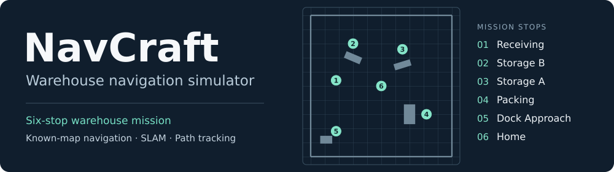
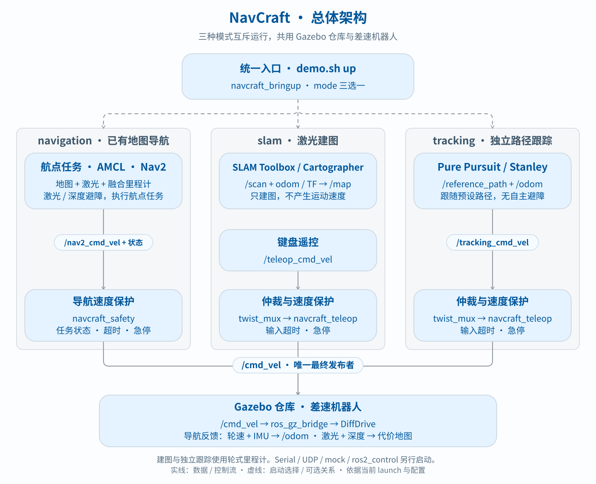

<h1 align="center"></h1>

<p align="center"><strong>Run a six-stop warehouse mission, map the aisles by hand, or compare two path-tracking controllers in Gazebo.</strong></p>

<p align="center">
  <a href="https://docs.ros.org/en/jazzy/"></a>
  <a href="https://gazebosim.org/docs/harmonic/"></a>
  <a href="https://releases.ubuntu.com/24.04/"></a>
  <a href="https://github.com/Vitolearns/NavCraft/tags"></a>
  <a href="LICENSE"></a>
</p>

<p align="center"><a href="#build">Build</a> &nbsp;·&nbsp; <a href="#run">Run a mode</a> &nbsp;·&nbsp; <a href="#architecture">Architecture</a> &nbsp;·&nbsp; <a href="docs/validation.md">Validation</a> &nbsp;·&nbsp; <a href="README.zh-CN.md">简体中文</a></p>

Nav2 provides localization, planning, and navigation control. NavCraft adds waypoint missions, pause/resume and cancellation, velocity protection, standalone Pure Pursuit / Stanley controllers, and reproducible simulation checks.

## Architecture



Each mode has one final `/cmd_vel` publisher. Navigation uses `navcraft_safety`; mapping and tracking use `twist_mux` and `navcraft_teleop`. In navigation mode, a planar EKF combines wheel motion and the IMU yaw rate into `/odom`. Nav2 combines the lidar scan and forward RGB-D camera depth in both obstacle maps. See [architecture and data paths](docs/architecture.md) for details.

## Build

Use **Ubuntu 24.04**, natively or in WSL2, with **ROS 2 Jazzy, Gazebo Harmonic, rosdep, colcon, and C++ build tools** installed. Run all commands in Bash:

```bash
git clone https://github.com/Vitolearns/NavCraft.git navcraft
cd navcraft
source /opt/ros/jazzy/setup.bash
# First rosdep use on this machine: run sudo rosdep init once.
rosdep update
rosdep install --from-paths src --ignore-src -r -y --rosdistro jazzy
bash scripts/build_ws.sh
```

The build script generates the warehouse map and builds all 13 packages. Outputs go to `build-navcraft/`, `install-navcraft/`, and `log-navcraft/`. If you already have the sources, use that checkout instead of cloning again.

## Run

| Mode | Use it for | Main components |
|---|---|---|
| `navigation` (default) | Navigate an existing map, avoid obstacles, and execute waypoint missions | Wheel/IMU EKF + AMCL + Nav2 + mission executor |
| `slam` | Drive the robot manually to build a map | SLAM Toolbox or Cartographer + keyboard control |
| `tracking` | Follow a predefined path and record tracking errors | Standalone Pure Pursuit or Stanley |

Run commands from the project root. **Start one mode at a time**; stop it with Ctrl+C in its launch terminal and wait for cleanup before switching. The default ROS domain is `73`; custom `ROS_DOMAIN_ID` values must match across terminals. `demo.sh` loads the ROS environment and sets `GZ_PARTITION` automatically.

### 1. Navigation

Terminal 1 — start Gazebo and RViz:

```bash
bash scripts/demo.sh up mode:=navigation gui:=true use_rviz:=true
```

Terminal 2 — submit a six-stop warehouse mission:

```bash
bash scripts/demo.sh warehouse
```

**Starting the system does not submit a mission.** The route visits receiving, storage B, storage A, packing, dock approach, and home. Use `bash scripts/demo.sh run` for a shorter two-waypoint run.

| During a mission | Command |
|---|---|
| Pause / resume | `bash scripts/demo.sh pause` / `bash scripts/demo.sh resume` |
| Cancel | `bash scripts/demo.sh cancel` |
| Watch state | `bash scripts/demo.sh status` (Ctrl+C to stop watching) |

For headless operation, set `gui:=false use_rviz:=false`. Route coordinates, obstacle insertion, and emergency-stop commands are in the [operating guide](docs/development.md#仓库导航与障碍演示).

### 2. SLAM

Terminal 1 — start mapping; replace `slam_toolbox` with `cartographer` to use the other backend:

```bash
bash scripts/demo.sh up mode:=slam slam_mode:=slam_toolbox gui:=true
```

Terminal 2 — load the environment and drive the robot:

```bash
source /opt/ros/jazzy/setup.bash
source install-navcraft/local_setup.bash
export ROS_DOMAIN_ID=73
export ROS_AUTOMATIC_DISCOVERY_RANGE=LOCALHOST
ros2 run navcraft_teleop keyboard_teleop_node --ros-args -p topic:=/teleop_cmd_vel
```

W/S changes forward speed; A/D changes turning speed; X or Space stops; Q stops and exits. **Releasing a key does not stop the robot.** Mapping itself does not drive or avoid obstacles. After stopping and exiting keyboard control, save the map in the same terminal while SLAM is still running:

```bash
bash scripts/save_map.sh my_map artifacts/maps
```

This writes `my_map.yaml` and `my_map.pgm`; it does not switch Nav2 to the new map. Cartographer currently runs without IMU input.

### 3. Path tracking

Start Pure Pursuit, or replace `pure_pursuit` with `stanley`:

```bash
bash scripts/demo.sh up mode:=tracking controller:=pure_pursuit gui:=true
```

The robot follows the bundled [demo path](src/navcraft_evaluation/paths/demo_path.txt) in the `odom` frame. This mode has **no global planning or laser-based obstacle avoidance**. Samples are written to `/tmp/navcraft_tracking.csv`; a summary is written to `/tmp/navcraft_tracking.json` on normal shutdown. Output paths and custom path configuration are covered in the [operating guide](docs/development.md#参数与入口).

The unified `use_rviz` option applies only to navigation. SLAM and tracking use `/enable_emergency_stop`; `demo.sh estop/release` apply to navigation. See [mode controls](docs/development.md#模式与急停).

## Development and documentation

`src/` contains the ROS packages; `scripts/` contains build, demo, and validation tools. After building, run:

```bash
python3 scripts/check_docs.py
bash scripts/test.sh
```

| Guide | Contents |
|---|---|
| [Architecture](docs/architecture.md) | Package responsibilities, control chains, sensors, and TF |
| [Development and operation](docs/development.md) | Warehouse demo, parameters, optional backends, and troubleshooting |
| [Validation](docs/validation.md) | Simulation commands, dated results, evidence, and coverage limits |
| [Licensing](docs/licensing.md) | License scope, commercial permission, and third-party notices |

Detailed guides are in Chinese. Validation covers simulation and software mocks; it does not establish real-hardware performance, mapping accuracy, or a controller ranking. The project focuses on a single robot; fleet scheduling, facility automation, and charging workflows are outside its scope.

## License

NavCraft is source-available under [PolyForm Noncommercial 1.0.0](LICENSE). Uses outside the license's permissions require separate written authorization. See [licensing](docs/licensing.md) and [NOTICE](NOTICE); third-party components retain their own licenses.
