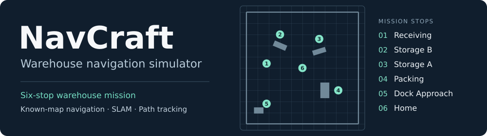
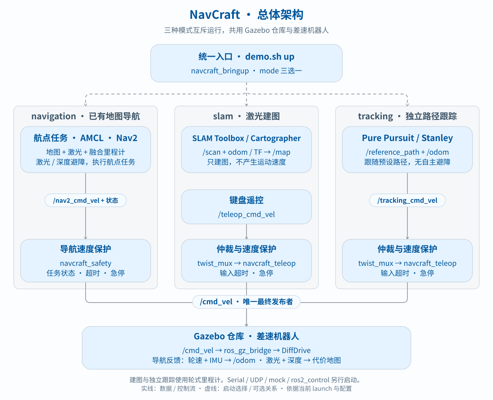

<h1 align="center"></h1>

<p align="center"><strong>在同一座 Gazebo 仓库中，运行六站导航任务、遥控建图，或比较两种路径跟踪器。</strong></p>

<p align="center">
  <a href="https://docs.ros.org/en/jazzy/"></a>
  <a href="https://gazebosim.org/docs/harmonic/"></a>
  <a href="https://releases.ubuntu.com/24.04/"></a>
  <a href="https://github.com/Vitolearns/NavCraft/tags"></a>
  <a href="LICENSE"></a>
</p>

<p align="center"><a href="#构建项目">构建</a> &nbsp;·&nbsp; <a href="#三种运行模式">运行模式</a> &nbsp;·&nbsp; <a href="#总体架构">总体架构</a> &nbsp;·&nbsp; <a href="docs/validation.md">验收记录</a> &nbsp;·&nbsp; <a href="README.md">English</a></p>

Nav2 提供定位、规划与导航控制；NavCraft 实现航点任务、暂停/恢复与取消、速度保护、独立 Pure Pursuit / Stanley 跟踪器，以及可复现的仿真检查。

## 总体架构



每种模式只有一个最终 `/cmd_vel` 发布者：导航使用 `navcraft_safety`，建图与跟踪使用 `twist_mux` 和 `navcraft_teleop`。默认导航用二维 EKF 融合轮速和 IMU 偏航角速度，输出 `/odom`。前向 RGB-D 相机的深度观测与激光共同更新 Nav2 的全局和局部代价地图。详细职责与数据链见 [架构文档](docs/architecture.md)。

## 构建项目

使用原生或 WSL2 中的 **Ubuntu 24.04**，预先安装 **ROS 2 Jazzy、Gazebo Harmonic、rosdep、colcon 和 C++ 构建工具**。以下命令均在 Bash 中执行：

```bash
git clone https://github.com/Vitolearns/NavCraft.git navcraft
cd navcraft
source /opt/ros/jazzy/setup.bash
# 本机首次使用 rosdep 时，先执行一次 sudo rosdep init。
rosdep update
rosdep install --from-paths src --ignore-src -r -y --rosdistro jazzy
bash scripts/build_ws.sh
```

构建脚本会生成仓库地图并编译全部 13 个包，产物位于 `build-navcraft/`、`install-navcraft/` 和 `log-navcraft/`。已有源码时进入实际项目目录，无需重复克隆。

## 三种运行模式

| 模式 | 用来做什么 | 主要组件 |
|---|---|---|
| `navigation`（默认） | 在已有地图中自主导航、避障和执行航点任务 | 轮速/IMU EKF + AMCL + Nav2 + 航点执行器 |
| `slam` | 人工遥控探索场景，建立地图 | SLAM Toolbox 或 Cartographer + 键盘遥控 |
| `tracking` | 跟随预设路径，记录跟踪误差 | 独立 Pure Pursuit 或 Stanley |

所有命令从项目根目录执行。**一次只启动一种模式**；切换前在启动终端按 Ctrl+C，并等待进程回收。默认 `ROS_DOMAIN_ID=73`，自定义时各终端必须一致。`demo.sh` 自动加载 ROS 环境并设置 `GZ_PARTITION`。

### 1. 已有地图导航

终端 1：启动 Gazebo 和 RViz。

```bash
bash scripts/demo.sh up mode:=navigation gui:=true use_rviz:=true
```

终端 2：提交仓库六站任务。

```bash
bash scripts/demo.sh warehouse
```

**启动系统不会自动下发任务。** 六站依次为 receiving、storage B、storage A、packing、dock 接近点和 home。短距离双航点演示使用 `bash scripts/demo.sh run`。

| 运行中操作 | 命令 |
|---|---|
| 暂停 / 恢复 | `bash scripts/demo.sh pause` / `bash scripts/demo.sh resume` |
| 取消任务 | `bash scripts/demo.sh cancel` |
| 查看状态 | `bash scripts/demo.sh status`（Ctrl+C 结束查看） |

无界面运行使用 `gui:=false use_rviz:=false`。站点坐标、障碍放置和急停操作见 [运行指南](docs/development.md#仓库导航与障碍演示)。

### 2. 激光建图

终端 1：启动建图。将 `slam_toolbox` 替换为 `cartographer` 可切换后端。

```bash
bash scripts/demo.sh up mode:=slam slam_mode:=slam_toolbox gui:=true
```

终端 2：加载环境并遥控机器人探索场景。

```bash
source /opt/ros/jazzy/setup.bash
source install-navcraft/local_setup.bash
export ROS_DOMAIN_ID=73
export ROS_AUTOMATIC_DISCOVERY_RANGE=LOCALHOST
ros2 run navcraft_teleop keyboard_teleop_node --ros-args -p topic:=/teleop_cmd_vel
```

W/S 调整前进速度，A/D 调整转向速度，X 或空格停车，Q 停车并退出。**松开按键不会自动停车。** 建图算法本身不驱动车辆，也不提供遥控避障。停车并退出键盘遥控后，保持 SLAM 运行，在同一终端保存地图：

```bash
bash scripts/save_map.sh my_map artifacts/maps
```

输出为 `my_map.yaml` 和 `my_map.pgm`，不会自动切换 Nav2 的地图。Cartographer 当前关闭 IMU 输入。

### 3. 独立路径跟踪

启动 Pure Pursuit；将 `pure_pursuit` 替换为 `stanley` 可切换控制器。

```bash
bash scripts/demo.sh up mode:=tracking controller:=pure_pursuit gui:=true
```

机器人启动后跟随 `odom` 坐标系下的 [预设路径](src/navcraft_evaluation/paths/demo_path.txt)。该模式**没有全局规划或激光避障**。采样写入 `/tmp/navcraft_tracking.csv`，正常退出时生成 `/tmp/navcraft_tracking.json` 汇总；输出路径和自定义路径配置见 [参数与入口](docs/development.md#参数与入口)。

统一入口的 `use_rviz` 仅对导航生效。SLAM 与跟踪的急停服务是 `/enable_emergency_stop`；`demo.sh estop/release` 用于导航，详见 [模式与急停](docs/development.md#模式与急停)。

## 开发与文档

`src/` 存放 ROS 包，`scripts/` 存放构建、演示与验收工具。构建后可运行：

```bash
python3 scripts/check_docs.py
bash scripts/test.sh
```

| 文档 | 内容 |
|---|---|
| [架构](docs/architecture.md) | 包职责、控制链、传感器与 TF |
| [开发与运行](docs/development.md) | 仓库演示、参数、可选底盘与故障排查 |
| [验收记录](docs/validation.md) | 仿真复现命令、带日期的结果、证据与覆盖范围 |
| [许可说明](docs/licensing.md) | 许可范围、商业授权与第三方通知 |

验收范围为仿真与软件 mock，不代表实车性能、建图精度或控制器性能排名。项目聚焦单车导航，不包含车队调度、设施自动化或自动充电业务。

## 许可证

NavCraft 使用 [PolyForm Noncommercial 1.0.0](LICENSE) 源码可见许可。超出许可证允许范围的使用需单独书面授权。详见 [许可说明](docs/licensing.md) 与 [NOTICE](NOTICE)；第三方组件保留各自许可证。
