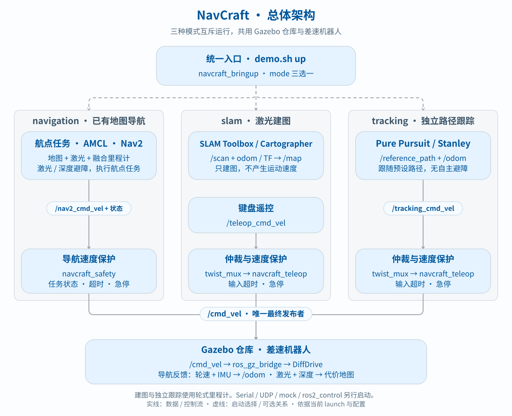
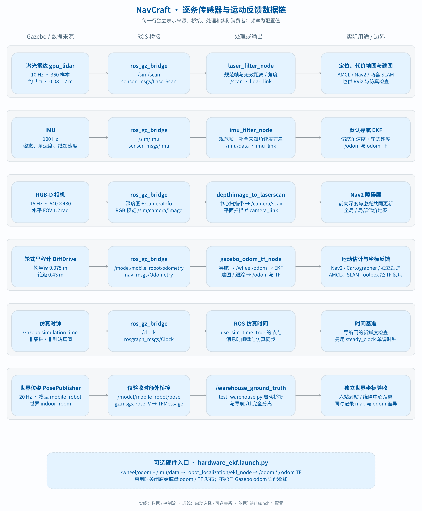
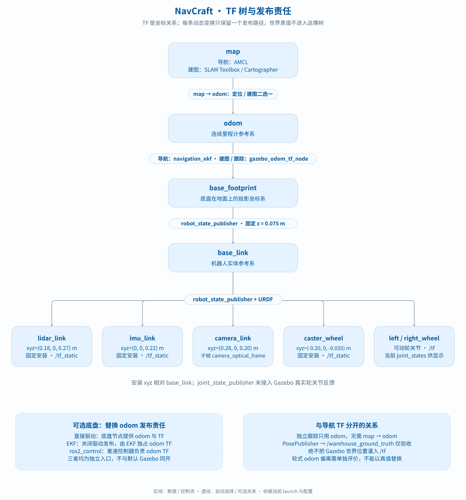
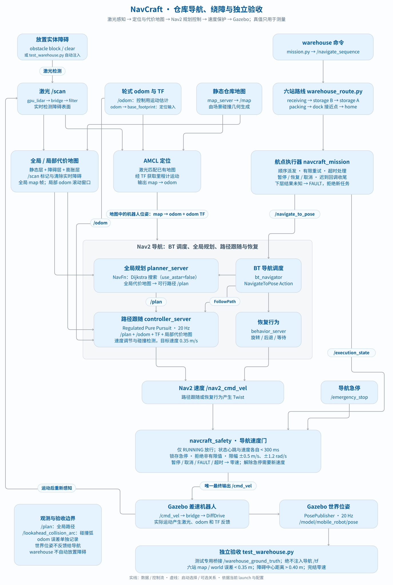

# 架构、传感器与 TF

本页描述当前源码的启动与数据关系。默认入口是 `scripts/demo.sh`，13 包名称统一为 `navcraft_*`。图中的可选模式不是同时运行；默认、可选和仅用于验收的路径分别注明。

从总体架构了解三种模式，再按需查看 [传感器与坐标](#3-传感器与坐标关系)、[导航闭环](#4-仓库导航闭环)、[任务状态机](#5-航点状态机与导航速度门) 和 [包职责](#6-13-包职责与源码入口)。图中的实线表示数据或控制流，虚线表示启动选择或可选关系。

## 1. 系统总览



入口调用链是 [demo.sh](../scripts/demo.sh) → [launch_demo.py](../scripts/launch_demo.py) → [navcraft.launch.py](../src/navcraft_bringup/launch/navcraft.launch.py)。启动器管理 ROS 域锁、Gazebo 分区和自身子进程回收；launch 根据 mode 选一条控制链。

| 模式 | 定位/数据 | 如何产生速度 | 最终发布者 |
|---|---|---|---|
| navigation | AMCL 使用预置地图、激光和融合里程计 TF。激光与相机深度共同更新障碍层 | 航点执行器驱动 Nav2，controller/behavior 输出 `/nav2_cmd_vel` | navcraft_safety/cmd_vel_safety_gate_node |
| slam | 激光与 odom/TF；SLAM Toolbox 或 Cartographer | 人工遥控 `/teleop_cmd_vel`；SLAM 只建图 | 默认 navcraft_teleop/cmd_vel_safety_gate_node |
| tracking | odom 帧参考路径 + `/odom` | 独立 Pure Pursuit 或 Stanley → `/tracking_cmd_vel` | 默认 navcraft_teleop/cmd_vel_safety_gate_node |

三模式的默认执行端都是 Gazebo DiffDrive。实验模式默认使用 twist_mux → `/muxed_cmd_vel` → 实验速度门；配置关闭 twist_mux 时由该包的自定义 mux 替代。Serial、UDP、mock、ros2_control 是独立底盘入口，不会自动加入默认仿真。

默认导航不运行独立 Stanley/PP。Nav2 默认控制器虽然也属于 Pure Pursuit 家族，实际用的是外部 **Regulated Pure Pursuit** 插件；仓库里的两种自研跟踪节点用于独立实验，不串联在 Nav2 后面。

## 2. 启动清单与可选模块

| 组件 | 导航 | 建图 | 跟踪 |
|---|---|---|---|
| sim.launch.py：Gazebo、桥接、传感器处理、URDF、odom TF | 启用 | 启用 | 启用 |
| AMCL、map_server、Nav2 导航服务 | 启用 | 关闭 | 关闭 |
| navcraft_mission + navcraft_safety | 启用 | 关闭 | 关闭 |
| map_manager | 启用 | 关闭 | 关闭 |
| 选定 SLAM 后端 | 关闭 | 启用 | 关闭 |
| path_publisher + 选定跟踪器 + experiment_runner | 关闭 | 关闭 | 启用 |
| navcraft_teleop 仲裁/保护 | 关闭 | 启用 | 启用 |
| RViz 参数 use_rviz | 控制是否开启 | 当前统一入口不使用此参数 | 当前统一入口不使用此参数 |
| 轮速/IMU EKF、深度图转扫描 | 启用 | 关闭 | 关闭 |
| 区域过滤器、高级 profile、health.launch.py | 默认均未启用 | 默认均未启用 | 默认均未启用 |

配置文件存在、包有依赖、模型有传感器，都不等于当前运行入口已使用它。节点是否启动以 launch 分支和条件为准。

## 3. 传感器与坐标关系

下表的频率来自仿真配置。默认导航把轮速和陀螺仪用于运动估计，把激光和相机深度用于障碍检测。世界位姿由验收脚本独立采集。



### 默认仿真数据路径

| 数据 | Gazebo 来源 / 配置 | ROS 桥接与处理 | 输出及用途 |
|---|---|---|---|
| 激光 | gpu_lidar；10 Hz，360 样本，约 ±π，0.08–12 m | ros_gz_bridge → `/sim/scan` → laser_filter_node | `/scan`，LaserScan，lidar_link；AMCL、代价地图、SLAM、RViz、验收 |
| IMU | imu；100 Hz，仿真器默认噪声设置 | `/sim/imu` → imu_filter_node | `/imu/data`，Imu，imu_link；导航 EKF 使用车体竖轴角速度 |
| 前向相机 | 导航使用 RGB-D，建图与跟踪使用 RGB。15 Hz，640×480，水平 FOV 1.2 rad | `/sim/camera/image` 提供 RGB 预览。默认导航另桥接 `/sim/camera/depth_image` 和 `/sim/camera/camera_info` | `depthimage_to_laserscan` 发布 `/camera/scan`，与激光共同标记和清除代价地图障碍 |
| 轮式里程计 | DiffDrive，轮半径 0.075 m、轮距 0.43 m | `/model/mobile_robot/odometry` → gazebo_odom_tf_node | 导航输出原始 `/wheel/odom` 给 EKF。建图和跟踪直接使用该适配器发布的 `/odom` 和 TF |
| 时钟 | Gazebo 仿真时钟 | `/clock` | Clock；use_sim_time 节点的时间源 |
| 世界位姿 | 模型 PosePublisher，20 Hz | 默认仅 Gazebo 发布；test_warehouse.py 额外桥接 `/model/mobile_robot/pose` | `/warehouse_ground_truth`，TFMessage；仅测量，不是导航 `/tf` |

消息类型分别属于 sensor_msgs/msg、nav_msgs/msg、rosgraph_msgs/msg、tf2_msgs/msg。源码：[sim.launch.py](../src/navcraft_simulation/launch/sim.launch.py)、[SDF](../src/navcraft_simulation/worlds/indoor_room.sdf.xacro)、[频率参数](../src/navcraft_simulation/config/simulation_physics.yaml)、[几何参数](../src/navcraft_description/config/robot_geometry.yaml)。

### 处理节点实际做什么

**激光**：[laser_filter_node.cpp](../src/navcraft_sensors/src/laser_filter_node.cpp) 规范 frame，按距离/角度处理无效样本，默认置 Inf，可配置顺时针反转。默认仿真直接启动它，不使用外部 laser_filters 链。

独立 [sensors.launch.py](../src/navcraft_sensors/launch/sensors.launch.py) 默认是另一条可选链：本项目节点 → `/scan_normalized` → laser_filters/scan_to_scan_filter_chain → `/scan`。不要与默认仿真同话题重复启动。

**IMU**：[imu_filter_node.cpp](../src/navcraft_sensors/src/imu_filter_node.cpp) 设置 `imu_link` 并保留仿真时间戳。Gazebo 未声明角速度协方差时，仿真入口配置每轴方差 0.0004 (rad/s)²。输入已提供的协方差和缺测标记会原样保留。

**相机**用 Gazebo 生成的深度图和内参，将图像中心 12 行投影为前向平面扫描 `/camera/scan`。`camera_optical_frame` 描述光学坐标，扫描使用朝前的 `camera_link`。全局和局部障碍层使用激光与该扫描，深度标记范围为 4 m，清除射线范围为 4.5 m。RGB 图像仍可用于预览。

**里程计**：[gazebo_odom_tf_node.cpp](../src/navcraft_simulation/src/gazebo_odom_tf_node.cpp) 调用 [planar_odometry.cpp](../src/navcraft_simulation/src/planar_odometry.cpp) 规范轮式测量的平面位姿和坐标帧。导航时它只发布 `/wheel/odom`。[二维 EKF 参数](../src/navcraft_simulation/config/navigation_ekf.yaml) 选用轮速的 vx、vy（无侧滑约束）和偏航角速度，并加入 IMU 的偏航角速度。编码器派生的位置、仿真绝对姿态和线加速度均不参与此估计。EKF 以 30 Hz 发布 `/odom` 和 `odom → base_footprint`。

### 各模式真正消费什么

| 消费者 | 激光 | 里程计/TF | IMU | 相机 |
|---|---|---|---|---|
| 导航 EKF | — | 订阅 `/wheel/odom`，发布 `/odom` 和 odom TF | 订阅 `/imu/data` 的角速度 | — |
| AMCL | `/scan` | 通过 TF 获取融合后的运动估计 | 经 EKF | — |
| Nav2 | 两张代价地图使用 `/scan` | 控制和导航使用融合 odom 与 TF | 经 EKF | 两张代价地图使用 `/camera/scan` |
| SLAM Toolbox | 使用 | 使用 odom/base_footprint TF | 当前不用 | 不用 |
| Cartographer | 使用 | use_odometry=true，使用 odom 与 TF | use_imu_data=false | 不用 |
| 独立 PP / Stanley | 不用 | 读取 `/odom` 和 `/reference_path`，路径配置为 odom 帧 | 不用 | 不用 |
| 仓库验收 | 检查感知与地图条件 | 记录地图、odom 和独立世界端点 | 不是到站判据 | 不是到站判据 |

独立跟踪没有自动转换任意路径帧，换路径须保持 odom 坐标一致；不会自动把激光障碍变成规划约束。Cartographer 的 imu_sampling_ratio=1 不代表启用了 IMU，真正开关是 use_imu_data=false。

配置：[nav2_basic.yaml](../src/navcraft_navigation/config/nav2_basic.yaml)、[slam_toolbox.yaml](../src/navcraft_navigation/config/slam_toolbox.yaml)、[cartographer.lua](../src/navcraft_navigation/config/cartographer.lua)、[tracking.launch.py](../src/navcraft_bringup/launch/tracking.launch.py)。

### TF 树及发布者



| 变换 | 发布者 | 条件 |
|---|---|---|
| map → odom | AMCL | 已知地图导航 |
| map → odom | SLAM Toolbox / Cartographer | 二选一建图，不与 AMCL 同开 |
| odom → base_footprint | navigation_ekf | 默认 Gazebo 导航 |
| odom → base_footprint | gazebo_odom_tf_node | Gazebo 建图或跟踪 |
| base_footprint → base_link | robot_state_publisher | URDF 固定关节，z=0.075 m |
| base_link → lidar_link | robot_state_publisher | 固定 xyz=(0.18, 0, 0.27) m |
| base_link → imu_link | robot_state_publisher | 固定 xyz=(0, 0, 0.22) m |
| base_link → camera_link | robot_state_publisher | 固定 xyz=(0.28, 0, 0.20) m |
| camera_link → camera_optical_frame | robot_state_publisher | 固定旋转，光轴朝 +Z |
| base_link → caster_wheel | robot_state_publisher | 固定 xyz=(-0.20, 0, -0.035) m |
| base_link → left_wheel/right_wheel | robot_state_publisher 读取 joint_states | 当前 joint_state_publisher 提供显示用关节状态，未桥接 Gazebo 真实轮反馈 |

安装位置相对 base_link，不是世界坐标。固定关系经 tf_static，可动轮关节经 tf。默认跟踪不发布 map→odom，此时缺 map 不自动代表故障。

独立底盘中，直接驱动可发布 odom TF；hardware_ekf.launch.py 关闭驱动 odom/TF，让 EKF 发布；ros2_control 由差速控制器负责。不能与 Gazebo odom TF 叠加。

### 可选 EKF 与硬件入口

[hardware_ekf.launch.py](../src/navcraft_hardware/launch/hardware_ekf.launch.py) 和 [ekf.yaml](../src/navcraft_hardware/config/ekf.yaml) 在 **navcraft_hardware**，不是 sensors 包。输入 `/wheel/odom` 和 `/imu/data`，由 robot_localization/ekf_node 输出默认映射到 `/odom`，开启二维和 TF 发布。

它不被 demo.sh up 引入。配置存在不等于融合精度验收；直接叠加会产生 odom/TF 多发布者。100D4 解析、Serial/UDP 也属于独立适配，不是默认仿真来源。

### 独立真值与检查

[test_warehouse.py](../scripts/test_warehouse.py) 每站记录世界位置、TF 地图位置和 `/odom` 估计。世界及地图到站阈值均为 0.35 m，odom 差异单记。历史表中的轮式里程计数据与当前 EKF 的结果按运行日期记录。

障碍距离是模型原点到障碍中心，不是车身净间隙。结果见 [validation.md](validation.md)。同域、同 overlay 下可检查：

```bash
ros2 topic hz /scan
ros2 topic hz /imu/data
ros2 topic info /wheel/odom --verbose
ros2 topic info /camera/scan --verbose
ros2 node info /navigation_ekf
ros2 topic info /odom --verbose
ros2 run tf2_ros tf2_echo map base_footprint
ros2 run tf2_ros tf2_echo base_link lidar_link
ros2 run tf2_ros tf2_echo base_link imu_link
ros2 run tf2_ros tf2_echo base_link camera_link
```

完整回归用 test_simulation.py，话题名存在不代表数据正常。

## 4. 仓库导航闭环



1. `warehouse` 通过 [mission.py](../scripts/mission.py) 读取 [warehouse_route.py](../scripts/warehouse_route.py)，提交 `/navigate_sequence`。
2. [航点执行器](../src/navcraft_mission/src/navigate_sequence_server_node.cpp) 依次调用 `/navigate_to_pose`，同时发布 `/execution_state`。
3. [nav.launch.py](../src/navcraft_navigation/launch/nav.launch.py) 启动定位和导航服务。map_server 发布预置地图，AMCL 结合 scan 与 odom TF 输出 map→odom。
4. [nav2_basic.yaml](../src/navcraft_navigation/config/nav2_basic.yaml) 配置 NavFn（use_astar=false，即 Dijkstra 路径搜索）、Regulated Pure Pursuit 控制、全局/局部代价地图以及恢复行为。两张代价地图均含 static、obstacle、inflation 层；障碍层接收 `/scan` 与 `/camera/scan` 进行标记与清除。
5. Nav2 产生 `/nav2_cmd_vel`，导航速度门过滤状态/超时/急停/限幅后，向 `/cmd_vel` 发布唯一最终指令，Gazebo DiffDrive 执行并产生新观测。
6. 仓库测试额外桥接世界位姿，核验六站位置和绕障距离，绝不将真值反馈导航。

`/plan` 是全局路径；`/lookahead_collision_arc` 是 RPP 碰撞检查弧，不是另一套局部优化轨迹。`warehouse` 本身不放障碍；`obstacle block/clear` 或 `test_warehouse.py` 才操作实体障碍。操作及站点坐标见 [仓库操作](development.md#仓库导航与障碍演示)。

## 5. 航点状态机与导航速度门

状态机由单线程、互斥回调驱动，不用 detached worker 或阻塞 future。有限序列仅接收 1–100 个 map 帧、有限坐标、近似单位四元数目标；loop 请求被拒绝，同时只占用一项任务。

| 状态 | 行为与退出条件 | 速度门 |
|---|---|---|
| IDLE | 等待合法序列；受理时立即预留为 RESERVED | 零速 |
| RESERVED / WAIT_SERVER | 完成任务占用，等待 Nav2 server；默认 10 s 超时失败 | 零速 |
| SENDING | 异步下发并等响应；默认 5 s 超时进入 FAULT | 零速 |
| RUNNING | 执行当前点；成功后下一个，ABORTED 每点最多重试一次；默认目标超时 120 s | 满足其他门控条件时放行 |
| PAUSING | 请求取消下层，等待目标结束；默认取消超时 5 s → FAULT | 零速 |
| PAUSED | 下层目标已结束，保留航点索引；恢复后重新等待/派发 | 零速 |
| CANCELING | 取消或目标超时收尾，确认下层结束后返回终态 | 零速 |
| FAULT | 下层接收/取消结果未知；拒绝新任务，迟到接收仍尝试取消 | 零速 |

Action 取消用 canceled 终态；通过服务取消时若外层 Action 尚未处于 canceling，则返回 abort，结果消息说明 cancelled。不能只看服务 success 就认为下层已停车。FAULT 不被迟到回调自动清除；需确认旧导航停止后整体重启。

[导航速度门](../src/navcraft_safety/src/cmd_vel_safety_gate_node.cpp) 每 20 ms 用 steady_clock 检查：RUNNING、未锁存急停、状态和速度各自小于 300 ms、linear.x/angular.z 为有限值。放行时限幅 ±0.5 m/s 与 ±1.2 rad/s，其他分量保持零；否则发零速。非 RUNNING 或急停切换清除缓存，解除需新速度。它不直接检查 scan/odom 新鲜度，也不等同于对所有传感器的安全监控。

实验门使用不同输入和超时配置，不能把上述导航故障测试结论套用到所有模式。默认导航不自动加载健康监督；手动急停服务可用。

## 6. 13 包职责与源码入口

| 包 | 核心职责 | 主要入口 / 边界 |
|---|---|---|
| navcraft_bringup | 模式编排 | launch/navcraft.launch.py；只选一条链 |
| navcraft_interfaces | 单车公共接口 | NavigateSequence Action、状态/误差消息、地图/底盘/控制服务；不是进程 |
| navcraft_mission | 航点与异步生命周期 | navigate_sequence_server_node；仅调用 Nav2，不做路径规划 |
| navcraft_navigation | AMCL/Nav2/SLAM 配置、地图目录和区域 | nav.launch.py 默认；profiles/zone_filters 为可选 |
| navcraft_tracking | 独立 PP/Stanley 与参考路径发布 | path_publisher_node、两个 controller；不做障碍规划 |
| navcraft_safety | 导航任务感知门控 | execution_state + nav2_cmd_vel + emergency_stop |
| navcraft_teleop | 实验仲裁、人工输入、急停 | cmd_vel_stack.launch.py；与导航门互斥 |
| navcraft_description | 统一几何与 URDF | robot_geometry.yaml、robot.urdf.xacro |
| navcraft_simulation | 仓库、桥接、仿真 EKF、深度扫描与 odom/TF | sim.launch.py、indoor_room.sdf.xacro |
| navcraft_sensors | 激光规范/过滤、IMU 帧适配、可选硬件解析 | 默认处理节点由 sim.launch.py 直接创建 |
| navcraft_hardware | 底盘协议、适配、标定、可选 EKF/ros2_control | 默认导航不调用该底盘路径 |
| navcraft_diagnostics | 聚合诊断、系统监测、故障监督 | 可选 health.launch.py；监督面向实验仲裁服务 |
| navcraft_evaluation | 跟踪误差/运动记录及 CSV/JSON | experiment_runner_node，跟踪模式启用；不是算法排名结论 |

依赖方向以 package.xml 为准：bringup 组织上层运行包；simulation 依赖 description/sensors；mission、tracking、evaluation 等共享 interfaces；hardware 依赖 description/interfaces。导航包的依赖还覆盖可选与测试入口，不能用 package.xml 推断运行拓扑。

## 7. 地图、扩展与设计取舍

预置地图由 `generate_map.py` 读取场景碰撞几何生成；它不是通过 SLAM 实测生成。map_manager 管理目录、元数据和区域查询，set_active_map 不等于在线热切 Nav2 map_server；区域 YAML 不代表默认已启用 costmap filter。

公共接口包集中定义消息和服务，航点 Action 服务负责有限序列的生命周期。仓库环境用于展示规划与避障；订单、设施预约、车队和充电业务不在平台范围。独立跟踪节点用于算法实验，主导航使用 Nav2。

仓库验收分别记录融合里程计、地图坐标和独立世界坐标。最新验证日期、误差和未执行项见 [validation.md](validation.md)。

## 8. 图的维护

README 只展示总体图；本页保留导航闭环、数据链和 TF 三张细节图。四张 SVG 的唯一可执行源为 [render_architecture.py](../scripts/render_architecture.py)，仅依赖 Python 标准库。中文字体回退见维护文档。修改配置、话题或职责时，同步修改图源与本页：

```bash
python3 scripts/render_architecture.py
python3 scripts/render_architecture.py --check
python3 scripts/check_docs.py
```

图中按消费者分别连接每类数据：SLAM 的运动来自遥控，AMCL 通过 TF 获取里程计运动；导航 odom、TF 和世界位姿分别表示运动估计、坐标关系与测量真值。可选模块标注启用条件，验收桥接与导航 TF 分离。
