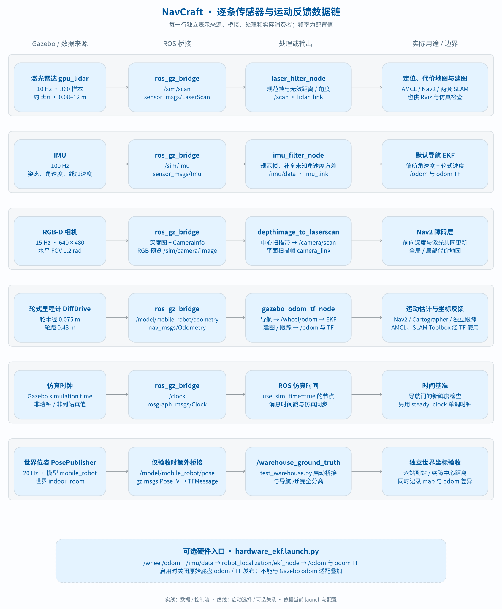
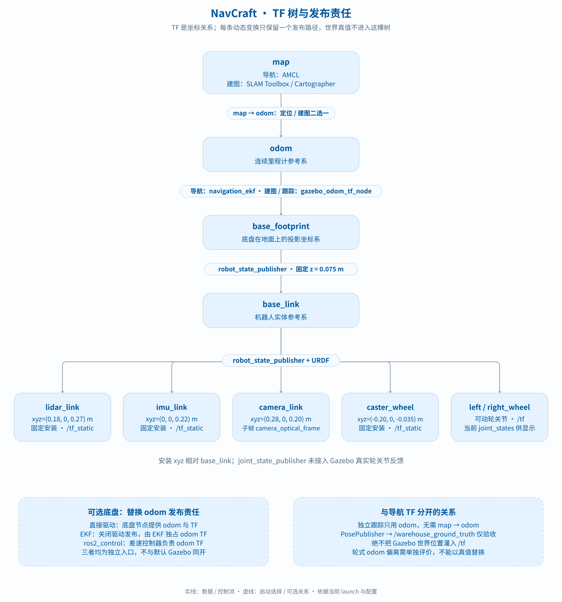

# 传感器、里程计与 TF

依据当前启动、SDF、节点和配置核对。表中频率为配置值，实际吞吐率需运行时测量。默认有三种传感器；里程计是运动估计，TF 是坐标关系，世界位姿是验收数据，不能统称“传感器融合”。



## 默认仿真数据路径

| 数据 | Gazebo 来源 / 配置 | ROS 桥接与处理 | 输出及用途 |
|---|---|---|---|
| 激光 | gpu_lidar；10 Hz，360 样本，约 ±π，0.08–12 m | ros_gz_bridge → `/sim/scan` → laser_filter_node | `/scan`，LaserScan，lidar_link；AMCL、代价地图、SLAM、RViz、验收 |
| IMU | imu；100 Hz，仿真器默认噪声设置 | `/sim/imu` → imu_filter_node | `/imu/data`，Imu，imu_link；观察与验收，未进入默认导航融合 |
| 相机 | camera；15 Hz，640×480，水平 FOV 1.2 rad，默认开启 | 桥接 `/sim/camera/image`，无视觉处理节点 | Image，camera_link；图像观察与验收，不用于识别/视觉 SLAM |
| 轮式里程计 | DiffDrive，轮半径 0.075 m、轮距 0.43 m | `/model/mobile_robot/odometry` → gazebo_odom_tf_node | `/odom`，Odometry；同时发 `odom → base_footprint` TF |
| 时钟 | Gazebo 仿真时钟 | `/clock` | Clock；use_sim_time 节点的时间源 |
| 世界位姿 | 模型 PosePublisher，20 Hz | 默认仅 Gazebo 发布；test_warehouse.py 额外桥接 `/model/mobile_robot/pose` | `/warehouse_ground_truth`，TFMessage；仅测量，不是导航 `/tf` |

消息类型分别属于 sensor_msgs/msg、nav_msgs/msg、rosgraph_msgs/msg、tf2_msgs/msg。源码：[sim.launch.py](../src/navcraft_simulation/launch/sim.launch.py)、[SDF](../src/navcraft_simulation/worlds/indoor_room.sdf.xacro)、[频率参数](../src/navcraft_simulation/config/simulation_physics.yaml)、[几何参数](../src/navcraft_description/config/robot_geometry.yaml)。

## 处理节点实际做什么

**激光**：[laser_filter_node.cpp](../src/navcraft_sensors/src/laser_filter_node.cpp) 规范 frame，按距离/角度处理无效样本，默认置 Inf，可配置顺时针反转。默认仿真直接启动它，不使用外部 laser_filters 链。

独立 [sensors.launch.py](../src/navcraft_sensors/launch/sensors.launch.py) 默认是另一条可选链：本项目节点 → `/scan_normalized` → laser_filters/scan_to_scan_filter_chain → `/scan`。不要与默认仿真同话题重复启动。

**IMU**：[imu_filter_node.cpp](../src/navcraft_sensors/src/imu_filter_node.cpp) 只改写 header.frame_id、转发和发布诊断。名字含 filter，但没有去噪、偏置估计、姿态滤波或融合；姿态数据来自 Gazebo。

**相机**：未桥接 CameraInfo，没有视觉算法或标定节点；URDF 没有独立 camera_optical_frame。图像及 camera_link 连通不代表完成标准视觉定位链。

**里程计**：[gazebo_odom_tf_node.cpp](../src/navcraft_simulation/src/gazebo_odom_tf_node.cpp) 调用 [planar_odometry.cpp](../src/navcraft_simulation/src/planar_odometry.cpp) 投影平面位姿、设置 odom/base_footprint、发布 odom 和 TF；不读取 IMU、不运行 EKF、不替换成世界真值。

## 各模式真正消费什么

| 消费者 | 激光 | 里程计/TF | IMU | 相机 |
|---|---|---|---|---|
| AMCL | `/scan` | 通过 TF 获取里程计运动，不直接订阅 odom 消息 | 不用 | 不用 |
| Nav2 | 代价地图使用 | 控制/导航用 odom 与 TF | 默认不直接用 | 不用 |
| SLAM Toolbox | 使用 | 使用 odom/base_footprint TF | 当前不用 | 不用 |
| Cartographer | 使用 | use_odometry=true，使用 odom 与 TF | use_imu_data=false | 不用 |
| 独立 PP / Stanley | 不用 | 读取 `/odom` 和 `/reference_path`，路径配置为 odom 帧 | 不用 | 不用 |
| 仓库验收 | 检查感知与地图条件 | 记录地图、odom 和独立世界端点 | 不是到站判据 | 不是到站判据 |

独立跟踪没有自动转换任意路径帧，换路径须保持 odom 坐标一致；不会自动把激光障碍变成规划约束。Cartographer 的 imu_sampling_ratio=1 不代表启用了 IMU，真正开关是 use_imu_data=false。

配置：[nav2_basic.yaml](../src/navcraft_navigation/config/nav2_basic.yaml)、[slam_toolbox.yaml](../src/navcraft_navigation/config/slam_toolbox.yaml)、[cartographer.lua](../src/navcraft_navigation/config/cartographer.lua)、[tracking.launch.py](../src/navcraft_bringup/launch/tracking.launch.py)。

## TF 树及发布者



| 变换 | 发布者 | 条件 |
|---|---|---|
| map → odom | AMCL | 已知地图导航 |
| map → odom | SLAM Toolbox / Cartographer | 二选一建图，不与 AMCL 同开 |
| odom → base_footprint | gazebo_odom_tf_node | 默认 Gazebo 三模式 |
| base_footprint → base_link | robot_state_publisher | URDF 固定关节，z=0.075 m |
| base_link → lidar_link | robot_state_publisher | 固定 xyz=(0.18, 0, 0.27) m |
| base_link → imu_link | robot_state_publisher | 固定 xyz=(0, 0, 0.22) m |
| base_link → camera_link | robot_state_publisher | 固定 xyz=(0.28, 0, 0.20) m |
| base_link → caster_wheel | robot_state_publisher | 固定 xyz=(-0.20, 0, -0.035) m |
| base_link → left_wheel/right_wheel | robot_state_publisher 读取 joint_states | 当前 joint_state_publisher 提供显示用关节状态，未桥接 Gazebo 真实轮反馈 |

安装位置相对 base_link，不是世界坐标。固定关系经 tf_static，可动轮关节经 tf。默认跟踪不发布 map→odom，此时缺 map 不自动代表故障。

独立底盘中，直接驱动可发布 odom TF；hardware_ekf.launch.py 关闭驱动 odom/TF，让 EKF 发布；ros2_control 由差速控制器负责。不能与 Gazebo odom TF 叠加。

## 可选 EKF 与硬件入口

[hardware_ekf.launch.py](../src/navcraft_hardware/launch/hardware_ekf.launch.py) 和 [ekf.yaml](../src/navcraft_hardware/config/ekf.yaml) 在 **navcraft_hardware**，不是 sensors 包。输入 `/wheel/odom` 和 `/imu/data`，由 robot_localization/ekf_node 输出默认映射到 `/odom`，开启二维和 TF 发布。

它不被 demo.sh up 引入。配置存在不等于融合精度验收；直接叠加会产生 odom/TF 多发布者。100D4 解析、Serial/UDP 也属于独立适配，不是默认仿真来源。

## 独立真值与检查

[test_warehouse.py](../scripts/test_warehouse.py) 每站记录世界位置、TF 地图位置和轮式 odom。世界及地图到站阈值均为 0.35 m，odom 差异单记。当前轮式 odom 偏离原因未逐项量化；AMCL 能修正地图定位，不代表里程计精度好，不能用真值喂导航来通过验收。

障碍距离是模型原点到障碍中心，不是车身净间隙。结果见 [validation.md](validation.md)。同域、同 overlay 下可检查：

```bash
ros2 topic hz /scan
ros2 topic hz /imu/data
ros2 topic info /sim/camera/image --verbose
ros2 topic info /odom --verbose
ros2 run tf2_ros tf2_echo map base_footprint
ros2 run tf2_ros tf2_echo base_link lidar_link
ros2 run tf2_ros tf2_echo base_link imu_link
ros2 run tf2_ros tf2_echo base_link camera_link
```

完整回归用 test_simulation.py，话题名存在不代表数据正常。
